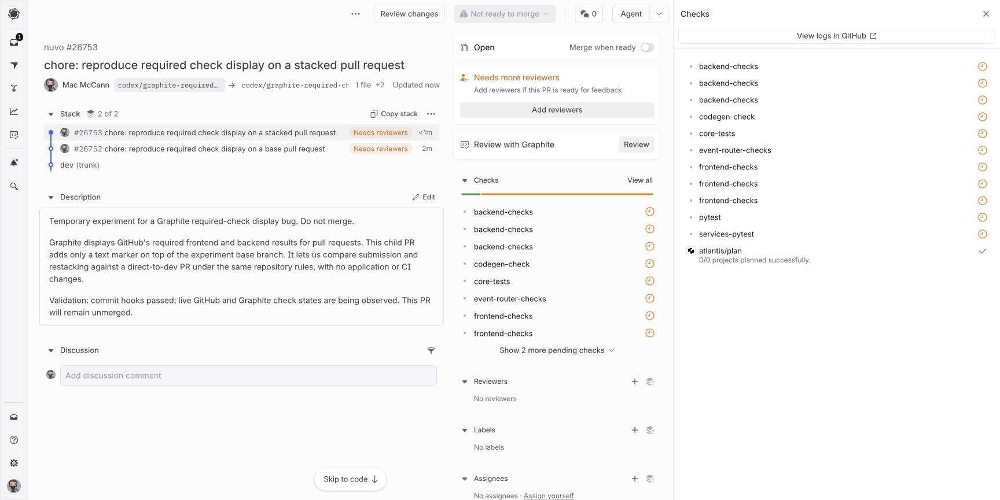
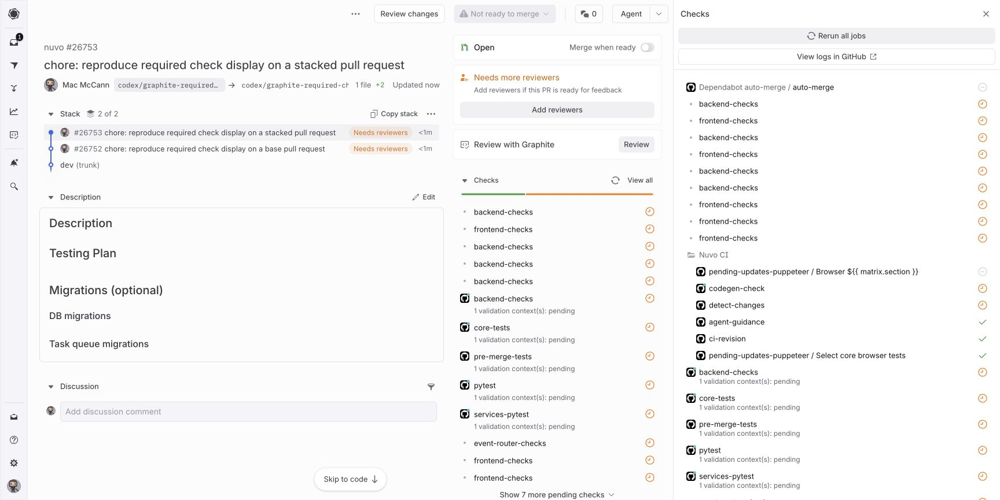
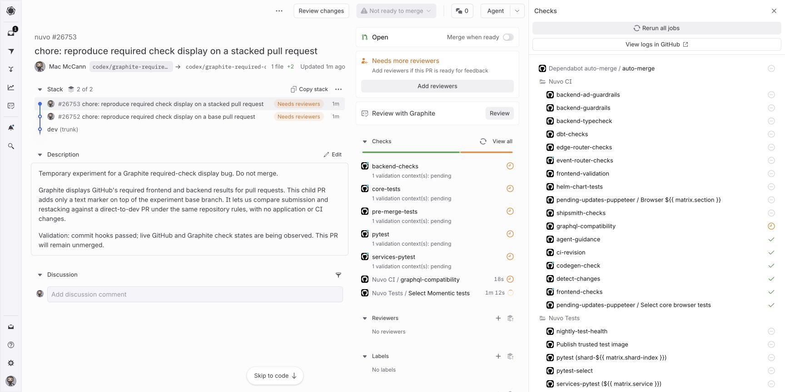
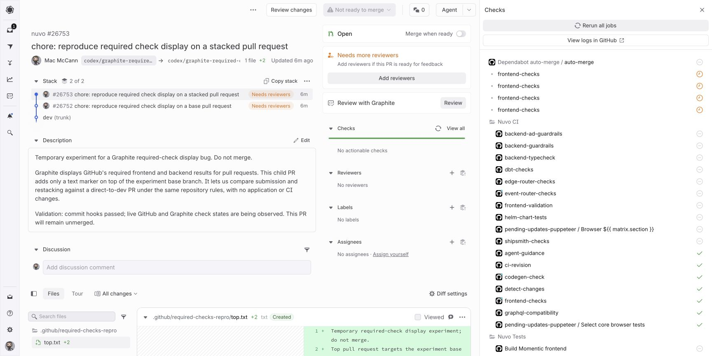

# Duplicate pending required checks in Graphite

**Confirmed on October 17, 2026 in `nuvo-tech/nuvo`.** Updating a two-PR stack while its Graphite page is open creates multiple plain pending rows for `frontend-checks` and `backend-checks`. GitHub requires each name exactly once. The extra rows are distinct from the actual Actions check and commit status.

This repository is the public bug-report bundle. The verified reproduction uses two text-only PRs in Nuvo; no application or workflow changes are needed. Small standalone controls in this personal repository did **not** reproduce the same multiplication. They are documented as controls, not represented as a confirmed independent reproducer.

## Captured result

The screenshot below was taken **2.889 seconds after `gt submit` finished**. Each required name appears three times as a plain pending row.



- Submission finished: `2026-10-17T12:38:48.483986Z`.
- Screenshot started: `2026-10-17T12:38:51.373Z`.
- Child head: `fd114941d1fb6ed28bc4bb75d7fa2007dd2e0ba6`.
- GitHub API capture at `12:38:57.841116Z`: neither required name had an actual check run or commit status yet on that head. Both names occur once in the effective `dev` rule.
- The parent was amended and the child restacked; no check definitions or repository rules changed.

See the [visible DOM snapshot](evidence/nuvo-immediate-update-dom.txt) and [GitHub API snapshot](evidence/nuvo-updated-github.json). Count rows within the **Checks tree**: the page also repeats the check list in its summary panel.

## Verified reproduction

Base PR: [GitHub #26752](https://github.com/nuvo-tech/nuvo/pull/26752) / [Graphite #26752](https://app.graphite.com/github/pr/nuvo-tech/nuvo/26752).

Child PR: [GitHub #26753](https://github.com/nuvo-tech/nuvo/pull/26753) / [Graphite #26753](https://app.graphite.com/github/pr/nuvo-tech/nuvo/26753).

These PRs contain only `.github/required-checks-repro/base.txt` and `top.txt`. They are experimental and must not be merged. Viewing or updating them requires Nuvo repository access; the evidence in this public repository does not.

1. Use a clean, isolated clone of `nuvo-tech/nuvo`, with current `dev` as Graphite's trunk. Import the existing experiment using `gt get --no-interactive --unfrozen codex/graphite-required-checks-repro-top`.
2. Open the child PR in Graphite and expand **Checks → View all**. Leave the page open. Reload before the experiment if old duplicates are already present.
3. Run the included [update script](scripts/update_nuvo_stack.sh) from that isolated Nuvo checkout. It changes one text line, amends the base commit, restacks the child, and submits both branches with Graphite.
4. **Within ten seconds of submission, capture the already-open Graphite page without reloading it.** We captured three plain pending rows per required name at +2.889 seconds.
5. Keep the page open while check updates arrive. Actual results can appear alongside older pending rows.
6. Capture the current page, reload it, and compare the rebuilt check list. In the initial experiment, reloading removed the accumulated duplicates while the actual backend status was still pending; CI did not need to complete first.

The exact number of rows depends on timing. A later reload can miss the bug. A screenshot of settled CI alone is not a reproduction.

## Expected and actual behavior

Expected: each required context has at most one missing-result placeholder. An arriving real check or status replaces that placeholder. Distinct real workflow runs may have their own results.

Actual: several indistinguishable, unlinked pending rows accumulate for the same context. They have a plain dot instead of the GitHub Actions icon or a target URL, and coexist with the real result.

An initial capture showed several plain pending copies alongside the genuine backend commit status:



GitHub's [initial API capture](evidence/nuvo-initial-github.json) contains one actual `frontend-checks` Actions check (success) and one current `backend-checks` status (pending). The backend's two historical status events are updates to the same context, not two requirements.

After a page reload, the same initial head had one frontend result and one backend status:



See [the reloaded DOM](evidence/nuvo-after-reload-dom.txt). The backend was still pending. This comparison separates UI recovery from completion of CI.

## Pending copies remain after success

At `12:43:37Z`, [GitHub reported](evidence/nuvo-green-github.json) one successful frontend check and one successful current backend status on the updated head. At `12:44:34.898Z`, the page still contained **four plain pending frontend rows alongside the successful frontend result**. The real backend status was also successful. The page summary said **“No actionable checks”** while the expanded Checks sidebar still showed the four pending copies.



Reloading the same page removed those four rows without a new push or rerun. See the [before DOM](evidence/nuvo-green-before-reload-dom.txt) and [after DOM](evidence/nuvo-green-after-reload-dom.txt).

## Cause and effect

**Established:** GitHub's effective rules contain exactly two entries, each bound to GitHub Actions (`integration_id: 15368`): `frontend-checks` and `backend-checks`. There is no classic `dev` branch-protection rule in the source repository. The extra plain Graphite rows are not additional configured GitHub requirements.

**Best-supported diagnosis:** Graphite's live check-list reconciliation retains or appends synthetic pending entries for required checks instead of consistently replacing/deduplicating them as updates arrive. The repeated rows, lack of real result URLs, coexistence with a real result, and improvement after a full page reload support this diagnosis. We have not inspected Graphite's source or internal event payloads, so the exact faulty function, event type, and deduplication key remain unproven.

A stack update can also produce more than one real `pull_request` workflow run for the same head; concurrency may cancel one. We observed that in the personal controls. That is a separate phenomenon: do not count cancelled real runs as evidence of the plain pending-row bug.

The verified effect is a misleading list of pending checks. This experiment does not prove that the duplicate rows alone block Graphite's merge queue or alter GitHub merge enforcement. No Nuvo PR was merged or queued during the experiment.

**Workaround:** reload the Graphite page after the real results have appeared. This cleared the accumulated rows in the observed comparison; it is not a fix for future live updates.

A likely fix should replace synthetic entries using a stable context/app identity, reset them when the PR head changes, and retire them when the corresponding real result arrives. These are proposed invariants, not a verified patch.

## Slow reporter experiment

The repository now includes approximately four-minute synthetic CI and the Nuvo status reporter logic, with only workflow names and a path adapted. See [setup, controls, and results](controls/slow-reporter.md). This experiment is intended to isolate the reporter; its outcome is recorded separately from the earlier controls below.

## Standalone controls and limits

The personal repository is public because GitHub Free does not support required-check rules on private repositories. It contains no Nuvo application source or credentials. Graphite was connected only to this new personal repository.

The original control uses two no-op jobs and a `workflow_run` reporter: one native `frontend-checks` result, one `backend-checks` commit status, and the same two required contexts on `dev`. The [ruleset payload](ruleset.json) has one entry per name.

Control stack: [GitHub #2](https://github.com/macmccann/graphite-required-checks-repro/pull/2) / [Graphite #2](https://app.graphite.com/github/pr/macmccann/graphite-required-checks-repro/2), then [GitHub #3](https://github.com/macmccann/graphite-required-checks-repro/pull/3) / [Graphite #3](https://app.graphite.com/github/pr/macmccann/graphite-required-checks-repro/3).

At +3.388 seconds after the first stack update, it displayed one pending row per name. Adding an unrelated workflow and then placing both native required jobs behind a 30-second prerequisite did not reproduce Nuvo's multiplication in the observed windows. See [control details](controls/README.md). Additional Nuvo/Graphite history or configuration may matter; a stack and the two requirements alone have not been shown sufficient.

## Inspect GitHub independently

Requires Python 3 and an authenticated GitHub CLI with repository read access:

```sh
python3 scripts/capture_github.py nuvo-tech/nuvo 26753 > github-snapshot.json
python3 scripts/capture_github.py macmccann/graphite-required-checks-repro 3 > control-snapshot.json
```

The script reads the current PR head, effective `dev` rules, actual check runs (including reruns), latest commit statuses, and historical status events. It performs no writes. Screenshots and DOM snapshots must be captured separately while the transient UI state is visible.

GitHub documents the distinction between [checks and commit statuses](https://docs.github.com/en/pull-requests/reference/status-checks) and [required-check evaluation](https://docs.github.com/en/pull-requests/how-tos/merge-and-close-pull-requests/troubleshooting-required-status-checks). A check and a status deliberately sharing the same required name can both be required; the original Nuvo comparison uses different names for those two mechanisms.
