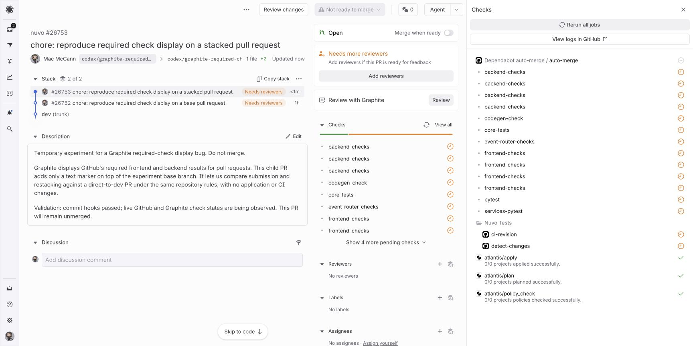

# Slow CI with the Nuvo status reporter

## Result: status publishing is not a necessary trigger

The personal repository now has slow CI and the full Nuvo reporter logic. Repeated status events, interrupted runs, and an on/off/on comparison did **not** reproduce the duplicated plain pending rows in the personal repository's observed windows.

The decisive control was in the already-reproducing Nuvo stack: remove only `# ci-aggregate-checks: v1` from its two producer workflows. The default-branch reporter reads that marker from the triggering head and returns before publishing when it is absent. After submitting that stack, Graphite showed **four `frontend-checks` placeholders and four `backend-checks` placeholders at +5.758 seconds**. GitHub's status history for that exact head contains only Atlantis statuses and none of the reporter's five contexts.



This rules out the reporter's status writes as a necessary trigger for the observed duplication. It does not establish Graphite's exact internal cause. The `workflow_run` jobs can still be invoked and return early; this control disables their publishing, not the workflow subscription itself. The personal fixture still is not a confirmed independent reproducer.

Both experiment stacks have reporting restored. The Nuvo experiment again has only its original text fixtures relative to `dev`; no Nuvo workflow or repository-rule changes were left in place.

## Observations

| Case | Head | Capture | Result |
| --- | --- | --- | --- |
| Personal reporter on; interrupt active slow CI | `ae87574ff1ea3745cc1cfe96a7fb0abc8f843c8f` | +2.815 s and +35.000 s | No multiplied placeholders observed; later API snapshot contains two events for each of five reporter contexts. |
| Personal reporter off; same jobs | `62f11fd2930be99e01b7ac1188fbd37081513f83` | +6.653 s and +36.063 s | One placeholder per required name; no commit statuses. |
| Personal reporter restored | `89448b7bac031731a18b7779560d9077787531dc` | +3.809 s and +118.533 s | One placeholder per name initially; later one frontend placeholder plus one backend status. Three events per reporter context in the saved progress snapshot. |
| Nuvo reporter publishing off | `f3bfd6a270810c42ab366f3df75b591b5c2f150d` | +5.758 s | Four plain pending copies per required name, with no reporter statuses. |

The personal page can lag the push, so an immediate capture alone is not the conclusion: the page remained open through later status events too. Screenshot and DOM capture occur consecutively; when an update arrives between them, the JSON counts describe the DOM snapshot rather than necessarily the preceding image.

Nuvo accumulated five frontend and six backend placeholders by `13:32:07.961Z`. Reloading reduced the observed list to zero frontend placeholders and two backend placeholders by `13:32:14.206Z`, while updates continued and the intentionally missing backend result remained pending. The earlier baseline experiment showed a clean reload after results settled; do not claim that reloading permanently prevents new copies during an active run.

Evidence:

- [Nuvo disabled-publishing screenshot](../evidence/slow-reporter/nuvo-off-immediate.jpg), [DOM](../evidence/slow-reporter/nuvo-off-immediate-dom.txt), [capture timestamp/counts](../evidence/slow-reporter/nuvo-off-immediate-capture.json), [submission timestamp](../evidence/slow-reporter/nuvo-off-submit.json).
- [Nuvo exact-head GitHub results and full status history](../evidence/slow-reporter/nuvo-off-github.json), [published control diff](../evidence/slow-reporter/nuvo-off-diff.json), and [restored submission](../evidence/slow-reporter/nuvo-restored-submit.json).
- [Personal reporter-on API snapshot](../evidence/slow-reporter/on-github.json), [reporter-off snapshot](../evidence/slow-reporter/off-github.json), and [restored reporter snapshot](../evidence/slow-reporter/restored-on-github.json).

## Run the personal comparison

Infrastructure: [GitHub #5](https://github.com/macmccann/graphite-required-checks-repro/pull/5) / [Graphite #5](https://app.graphite.com/github/pr/macmccann/graphite-required-checks-repro/5), merged to `dev` at `2026-10-17T13:26:41Z`.

Experiment base: [GitHub #6](https://github.com/macmccann/graphite-required-checks-repro/pull/6) / [Graphite #6](https://app.graphite.com/github/pr/macmccann/graphite-required-checks-repro/6). Child: [GitHub #7](https://github.com/macmccann/graphite-required-checks-repro/pull/7) / [Graphite #7](https://app.graphite.com/github/pr/macmccann/graphite-required-checks-repro/7). Do not merge these experimental PRs.

Use a clean clone with GitHub CLI and Graphite authenticated. Keep the helper outside the checkout because it switches branches. The helper verifies the personal repository origin and refuses a dirty checkout.

```sh
git fetch origin dev
git show origin/dev:scripts/update_personal_stack.py > /tmp/update_personal_stack.py
git show origin/dev:scripts/capture_github.py > /tmp/capture_github.py
gt get --no-interactive --unfrozen slow-repro-top
python3 /tmp/update_personal_stack.py --reporter on --output /tmp/reporter-on-submit.json
# Capture the already-open Graphite child page immediately, and again as updates arrive.
python3 /tmp/capture_github.py macmccann/graphite-required-checks-repro 7 --all-checks > /tmp/reporter-on-github.json
python3 /tmp/update_personal_stack.py --reporter off --output /tmp/reporter-off-submit.json
# Repeat UI/API capture; backend remaining pending is expected in this control.
python3 /tmp/update_personal_stack.py --reporter on --output /tmp/reporter-restored-submit.json
```

Validation: JavaScript syntax and all workflow YAML parsing passed; the reporter matches the source after reversing only its three naming/path substitutions; 80 applicable existing reporter tests passed locally. Four Nuvo application-workflow tests were excluded because their application jobs are absent here. The synthetic workflow job names were also passed through the reporter and produced all five expected successful gates. Temporary validation artifacts are at `/tmp/slow-reporter-validation` on the author's machine; they are not required to run this public fixture. With Node.js installed, the exact local command was:

```sh
node --test --test-skip-pattern='backend eligibility|Momentic frontend build|routine Momentic' /tmp/slow-reporter-validation/scripts/ci-retry-status.test.cjs
```

Result: 80 passed, zero failed. These local artifacts are not durable or available on other machines.

## Fixture implementation

The personal repository now runs synthetic jobs for about four minutes. `Repro CI` waits 90 seconds before scheduling `frontend-checks` and three backend jobs; those jobs then wait another 90–120 seconds. `Repro Tests` produces the test matrix and auxiliary statuses that the Nuvo reporter expects. Every job only sleeps or runs a no-op.

The reporter preserves the Nuvo implementation from commit `22125b35c8`: the only substitutions are `Nuvo CI` → `Repro CI`, `Nuvo Tests` → `Repro Tests`, and the CI workflow path → `.github/workflows/checks.yml`. It handles `workflow_run` requested/in_progress/completed events, groups competing runs by validation context, follows a surviving run after duplicate cancellation, reads revision stamps, rechecks run state before publishing, and writes statuses to the PR head SHA. The workflow serializes writes by producer workflow and head SHA and checks out its trusted default-branch revision.

`frontend-checks` is a native Actions check. `backend-checks` is exclusively a commit status from the reporter. The other reported contexts are `pytest`, `services-pytest`, `core-tests`, and `pre-merge-tests`. The two existing required-check rules remain unchanged.

The reporter must first be merged to the default branch: a reporter edited only in a PR does not change the `workflow_run` implementation GitHub executes. During the infrastructure PR, the previous default-branch reporter supplies its existing backend status; experiments begin after the new reporter has landed.

For an on/off comparison on an experimental stack, remove only `# ci-aggregate-checks: v1` from both producer workflows. This makes the same reporter return without publishing statuses. Backend then intentionally remains unsatisfied; this control tests display behavior and must not be merged. Restore the exact marker to re-enable publishing. Keep the same delays, required rules, and workflow jobs.

Capture the already-open Graphite child page within ten seconds of a stack submission, then capture again as status updates arrive. Compare the visible rows with the GitHub API and with the same page after reload. A cancelled real workflow run is not a duplicated synthetic pending row.

The evidence above distinguishes this faithful reporter control from a successful independent reproduction.
